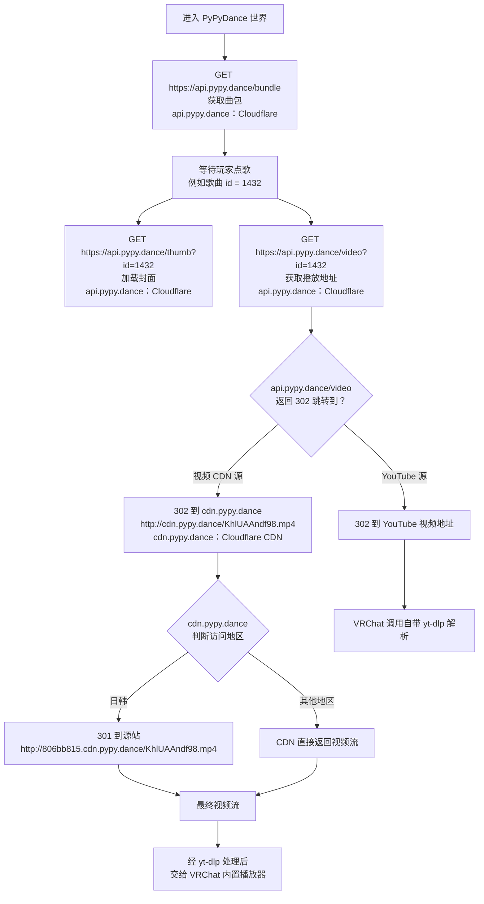
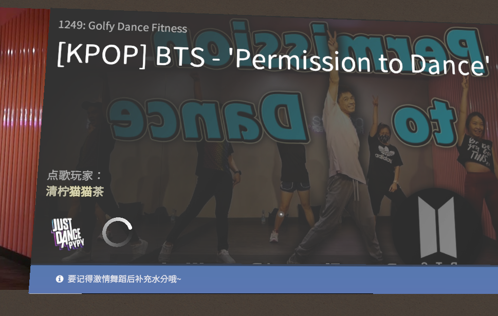
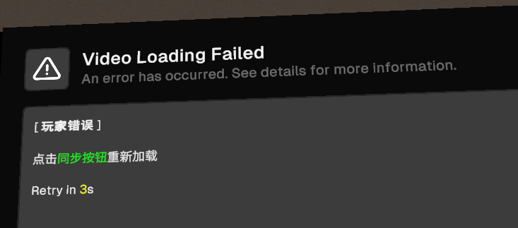
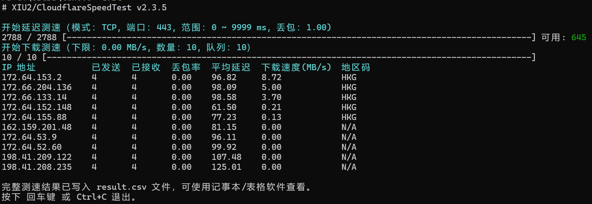
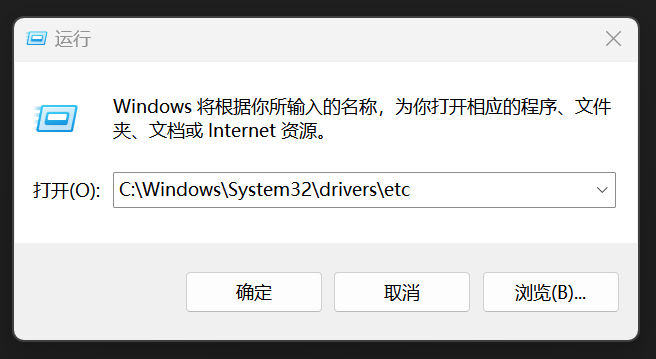
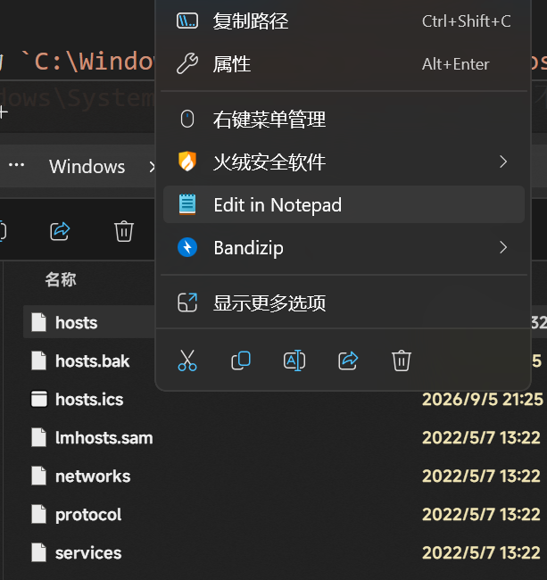
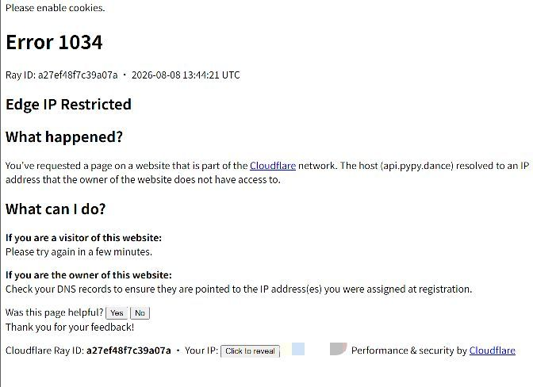

# 关于VRCHAT舞蹈房各种问题的分析与推荐的解决方案

## 前言

本文介绍的相关内容都是我自行测试得到的结果，并不一定正确。只是提供解决问题的可行的方案，具体来看每个人的问题都有所不同，没有那种方案能够一次解决所有的问题
如果文中有内容错误或有更好的解决方案，欢迎在issue里创建，非常感谢纠正和建议!

## PyPyDance 的视频加载流程（不想看可以跳过）

pypydance拥有自己的存储视频的服务器,并且使用了cloudflare CDN进行全球加速和缓存，pypydance绝大多数的视频都存储在自己的视频服务器上，只有少部分视频使用了youtube视频源 （大多都位于 Others 分类下，Songs的歌曲使用youtube视频源）。对于使用youtube视频源的视频只能使用代理来播放，使用cloudflare cdn的可以通过非代理手段尽力优化从而达到不错的播放效果。下面简单的写下pypydance播放视频的接口和流程，这些信息使用观察得到，可能不完全正确，测试也并不充分

pypydance主要使用如下三个域名进行服务,在这里简要列出他们的功能和采用的服务器
| 域 | 功能 | 服务器 |
|---|---|---|
| `api.pypy.dance` | 获取曲包、加载封面、重定向视频播放地址 | Cloudflare |
| `cdn.pypy.dance` | 视频 CDN，负责实际视频分发，并按地区决定是否回源 | Cloudflare CDN |
| `806bb815.cdn.pypy.dance` | 视频源站 | kt.com（可能，有公网ipv4） |

1. 进入 PyPyDance 世界时
   - 客户端向 `https://api.pypy.dance/bundle` 发送 GET 请求，获取完整曲包。 每首歌都有独立 id，例如 `1432`。

2. 玩家点歌后，客户端会请求：
   - `https://api.pypy.dance/thumb?id=1432`：加载封面图。
   - `https://api.pypy.dance/video?id=1432`：获取视频播放地址。

3. `api.pypy.dance/video` 会根据视频源返回 `302` 重定向：
   - 如果是视频 CDN 源，重定向到 `cdn.pypy.dance`，例如  
     `http://cdn.pypy.dance/KhlUAAndf98.mp4` 其中`KhlUAAndf98.mp4`为视频文件名,同一个视频文件名唯一。
     **值得注意的是，这里使用的http`协议，经过测试https协议是不可以的,会SSL 握手错误**
   - 如果是 YouTube 源，重定向到 YouTube 视频地址。

4. 如果进入 `cdn.pypy.dance`，它会继续判断访问者所在地区：
   - 如果是日本或韩国，返回 `301` 永久重定向到源站，例如  
     `http://806bb815.cdn.pypy.dance/KhlUAAndf98.mp4`。  
     视频文件名保持不变。
   - 如果不是则由 CDN 直接返回视频流。

5. 播放解析阶段：
   - YouTube 源：VRChat 调用自带的 `yt-dlp` 解析。
   - 非 YouTube 视频源：经过 `yt-dlp` 处理后，交给 VRChat 内置播放器播放。
   - 播放时使用 Range 请求，因此可能会多次请求 `cdn.pypy.dance`，并收到  
     `206 Partial Content`。

上述内容可能看的一头雾水? 为了方便展示下方绘制了详细的流程图



## 常见问题与原因总结 （不想看也可以跳过）

首先我用最直接，最真实，最不绕弯子的方式告诉你，**大多数问题都是Cloudflare在国内访问不稳定造成的** （减速cdn和开门红这一块）在上一部分加载流程介绍里我们不难发现，所有的请求几乎都要经过cloudflare服务器（不管是API还是CDN）。这不是pypydance服务器的问题,也不是你的宽带的问题，而是Cloudflare分配给国内访问者的IP节点质量不太好——延迟高、丢包多、速度慢。

**具体体现**
cloudflare服务器可能会分配距离很远的服务器IP（这里的距离是网络拓扑上的，但是基本和空间距离正相关），你在北京，你附近有位于NRT(东京)的服务器,位于HKG(香港)的服务器,位于ICN(首尔)的服务器，但是给你分配位于SJC(圣何塞) SEA(西雅图) LHR(伦敦)的服务器。这也不能完全将责任推给Cloudflare，也受制于三大运营商的线路等，Anycast是一个很复杂的系统。

> *这就好比你在北京，点了家附近奶茶店的冰鲜柠檬水，外卖平台却给你分配了一个广东的骑手配送，骑手日夜兼程，送到你手上的时候已经是水水柠檬水水了，这样你不仅延迟变高了，而且速度还变慢了啊，好事全让你赶上了*

可以访问 [https://speed.cloudflare.com](https://speed.cloudflare.com) 查看cloudflare为你分配的服务器和详细的测速情况。

**对你来说造成的问题有**

- 进去卡在一个黑色的空间让你打开允许访问未知网址,就算打开了也还是这样
- 视频播放一卡一卡
- 别人都跳一半了才刚刚加载出来
- 加载出来刚准备跳又卡了
- 刷新几次加载出来然后玩家错误了
- ...




**我知道这可能很折磨心态，但是这个问题是可以解决的！**

## 几种解决办法
如果你并没有查看上两个部分的内容直接跳到这里的话，说明你很想解决这个问题，但是你先别急。我需要先说一下:
_这个问题的成因很复杂，所以并没有一劳永逸的方法，网络环境和服务器状态都是实时变化的，当前有效的方法并不能保证一直有效。部分解决方法需要你有一点计算机知识。我并非擅长这方面，我只是尽力的把我做的事情描述出来。所以如果有说的错误的地方欢迎指正！有更好的办法如果愿意分享的话我真的由衷的感谢，因为我也被这些问题困扰许久了。_

### 1. 使用代理工具
如果你并不想折腾什么优选ip，优选域名，修改hosts等复杂的，不稳定的方案，使用代理工具可能是很好的选择！

只要你的节点质量和速度还算ok，那么加载视频应该不会成为问题。这种解决办法相对来说稳定的多，但是你的订阅可能是付费的，的确播放视频会消耗掉一些流量（这里按照我测试跳舞一个半小时大约消耗1.5G-3G的流量，可能根据自身的情况酌情考虑），如果你的流量真的很多那这种方法省心省力为什么不试试呢？

> *按照刚才的外卖举例，这种方式相当于把你的家直接搬到了奶茶店旁边，距离只有50m，大多数情况下可以很快的送达，甚至骑手直接手拿奶茶，瞄准你家的窗户，超级无敌托马斯回旋把奶茶扔到你的手里直接来一个暴风吸入....(这是我瞎编的) [https://www.bilibili.com/video/BV1cogw6uE9F](https://www.bilibili.com/video/BV1cogw6uE9F)*

**在这里有几点需要注意**

> 这里是用Clash Meta或Clash Verge举例

- 我们上文说过，如果你的ip位于日韩会被301重定向到源站，如果你使用日本或者韩国的节点，同样会被重定向到源站。请确保你的代理工具能够访问到源站并且速度相对来说可以。</br>**不过为了稳定，重定向也需要额外的延迟，所以推荐不使用这两个地区的节点。比较好的是香港或者新加坡，这两个地区都有临近的cloudflare服务器(HKG,SIN)，可以快速播入，而且直接走`cdn.pypy.dance`的cloudflare CDN加速，速度相当可观**
- 部分代理工具可能会内置规则，将`pypy.dance`走`DIRECT`,这可能会让你代理不生效
- 如果你的VRCHAT加速器和代理工具冲突，可以在代理工具排除vrchat相关的域名 `*vrchat.com` `*vrchat.cloud`,或者配置这两个域名为 `DIRECT`
- 部分加速器例如UU加速器，会提示`检测到电脑正在运行其他网络代理，可能导致游戏相关页面无法开启...`,如果你点击自动修复，你的代理会被UU关闭，所以记得选择`暂不开启`
- 部分订阅晚高峰不稳定，或者可能因为某些原因无法正常工作，这种只能...

**总结**
- 确保代理生效
- 避免和游戏加速器冲突
- 代理最好避免使用日韩的节点,改用香港或新加坡
- 注意流量消耗 
- 剧烈运动后记得及时补水


### 2. 进行Cloudflare优选
> [!IMPORTANT]
> 这种方法需要具备一点电脑知识

这种方法的核心就是，测试众多的cloudflare服务器的ip，找到对于你来说速度最快的那一个，通过修改系统hosts文件的方式，让前往`api.pypy.dance`和`cdn.pypy.dance`的请求直接前往这个ip，避免有大病的分配，从而达到不错的效果，可以理解为优选。

**优选主要有以下几种方式**

#### 1. 用手一个一个测，开玩笑，这不可能

#### 2. 使用Cloudflare Speed Test
`Cloudflare Speed Test`是一个开源的测试 Cloudflare CDN 延迟和速度，获取最快 IP 的工具，地址: [https://github.com/XIU2/CloudflareSpeedTest](https://github.com/XIU2/CloudflareSpeedTest) 具体用法查看这个项目的文档。

这个工具不使用代理，不会修改你的具体IP，访问质量也更多取决于你的网络质量。它不是加速你的访问，只是让你避免被分配到速度差的节点，从而让你的速度达到你本来就应该有的速度。但是这种方式也更多受限于运营商的速度，在晚高峰期间可能质量会下降，特别是请求很多的节点例如HKG，不太理解？看下面的例子 ↓

> *还是按照刚才外卖的例子，这个工具并没有改变你家到商家的距离，但是给你分配了一个就在附近接单的骑手，你们一拍即合，很快就送达了。但是要是遇到晚高峰，商家到你家的路堵得水泄不通，况且商家参加了0.01元喝奶茶活动，一分钟要做200多单已经忙的起火了，你的餐大概还是要等很久，真的很久*

下面只讲测出来后如何用


1. 完成测试后大概结果如上图,其中第一栏为ip地址，选取一个较好的ip地址（一般就是第一个）**在这里我们看到 位于HKG的`172.64.153.2`这台服务器 下载速度达到了`8.72MB/s`,质量很好，所以我们选择ip `172.64.153.2`**

2. 打开系统的hosts文件, 如果你是Windows, 路径为 `C:\Windows\System32\drivers\etc\hosts` </br> 
   - 使用Win+R打开运行窗口, 在里面输入 `C:\Windows\System32\drivers\etc` (注意是 \ 不是 /),按下回车
   
   - 在打开的文件管理器窗口,选择`hosts`文件,选择使用记事本打开
   
   - 在文件结尾新增如下内容
   ``` txt
   172.64.153.2 api.pypy.dance
   172.64.153.2 cdn.pypy.dance
   ```
   </br>注意 `172.64.153.2` 是你刚才测出来的IP，不要照抄我的，这只是一个示例，**同时注意ip和后面的域名之间至少要有一个空格！**
   - 保存文件(或者快捷键 `Ctrl + S`)

3. 在游戏里重新加载视频 (hosts生效不是立即的,重新加载一下最好)

**需要注意的事情**
- **cloudflare的ip不是一成不变的，例如上文测到的`172.64.153.2`，cloudflare会根据流量动态调度，这个ip可能会随时失效或者速度变得没有之前那么快，此时你需要重复上述的步骤测试出一个新的ip并替换**
- **测试时请不要使用代理工具，这会造成结果不可用**
- 推荐在每次修改hosts前备份hosts内容以便修改错误后能及时恢复
- **为什么我有段时间测试出的ip速度都特别慢？** 晚高峰可能存在限速或者出网拥塞，没什么办法，只能等一会

**Error 1034错误怎么办？(这个问题少见但是不是不可能)**



为什么会有这个错误? cloudflare分为免费计划和付费计划，有些ip是只有付费计划才可以使用的，但是pypydance用的是免费计划，当你向一个付费计划的ip去请求一个免费计划的网站时，cloudflare就会阻止你的这次请求，并返回错误页面 (Error 1034 边缘节点受限)

这往往是因为你再测试IP访问速度时，使用了那些以付费计划运行的网站或者服务器，因此测出的ip为付费计划的ip，在Cloudflare Speed Test中 `-url` 表示测速地址，确保它可用且处于免费计划！

#### 3. 使用 cfsf
cfsf(Cloudflare Speed Fix)是开源的软件，用于自动完成IP测试并持续更新hosts来提高可用性...


## TO BE CONTINUE 写太多累了，我要去吃点好吃的